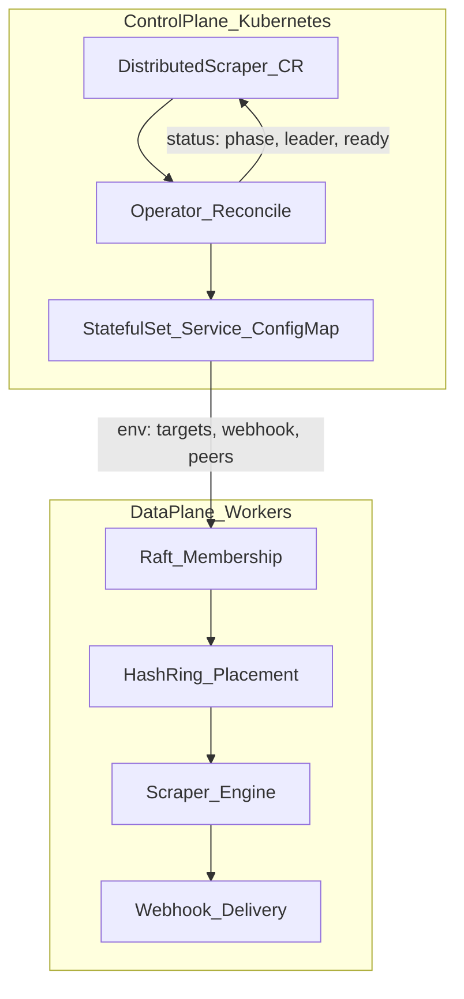

# Affinity — Architecture Phases

A build order for **thinking** about the distributed scraper system, not a feature checklist. Each phase should end with written **invariants** ("what must always be true") before implementation.

## The Spine



- **Control plane** = how many workers, what targets, what webhook.
- **Data plane** = who owns which target right now, scrape it, notify.

Do not mix those concerns in one pass.

---

## Phase 1 — Boundaries and Guarantees ✅ Complete

**Status:** Done. No code in this phase — design contract only. Implementation starts at Phase 2.

### Decisions

| Question | Affinity answer |
| --- | --- |
| What is the unit of work? | One **target** (series ID) polled on `syncInterval` |
| What is success? | New chapter detected and delivered with **idempotent** webhook effects — practically once per user-visible alert |
| What can fail? | Worker death, leader death, scrape errors, webhook timeout/5xx, network partition |
| What consistency do we need? | At-least-once scrape + at-least-once delivery attempts + **idempotent effects** (not exactly-once end-to-end) |
| Webhook on timeout | **Unknown** — verify local outbox state before retry; do not assume failure |
| Delivery state store | **Leader-replicated via Raft** — simplifies ring rebalance and failover (successor reads same outbox) |
| Scrape retry policy | Exponential backoff on failed scrapes, capped at ~10 minutes |
| Leader election SLO | New leader elected in **< 300ms** |
| Failover SLO | On worker death, load reassigned to ring neighbors in **< 10s** total |

### System invariants

1. Every target in `spec.targetList` is owned by exactly one **live** worker at steady state.
2. A webhook for `(target, chapter)` is never duplicated in **normal operation** (idempotency key + durable outbox + fencing).
3. On worker death, load transfers to neighbors on the hash ring within 10 seconds.
4. New Raft leaders are elected within 300ms.
5. Failed scrapes retry with exponential backoff until ~10 minutes.
6. Webhook delivery is **not** complete until ack is recorded in leader-replicated outbox; timeout = unknown, not failed.
7. Stale workers (zombies) cannot commit delivery state after ring epoch advances (fencing).

### Delivery model (webhook)

```
detected → delivery_pending (Raft outbox) → POST → delivered | retry_if_still_pending
```

- **Idempotency key:** `(target_id, chapter_number)`
- **On timeout/partition:** treat as unknown; consult outbox before retrying POST
- **Tradeoff accepted:** optimize for **no missed alerts**; duplicates prevented by idempotent outbox + dedupe key, not by hoping the network is reliable

**Repo touchpoint:** `api/v1/distributedscraper_types.go` — Spec encodes *desired* state; Phase 2+ encodes *observed* state to match these guarantees.
---

## Phase 2 — API: Desired vs Observed ✅ Complete

**Status:** Done. Spec unchanged; Status semantics locked for MVP.

### Decisions

| Topic | Decision |
| --- | --- |
| Where Status lives | On the **CR** — durable, aggregated cluster truth; not only worker logs |
| Phase vs conditions | **`phase`** = lifecycle; **`conditions`** = health detail |
| Partial worker readiness | `phase: Running` + `WorkersReady=False` (not `Degraded`) |
| No Raft leader | `phase: Running` + `LeaderElected=False` |
| `Degraded` phase | **Unused for MVP** — rely on conditions instead |
| Phase transitions (MVP) | `Pending` → `Provisioning` → `Running` |

### Phase transitions

| Phase | When |
| --- | --- |
| `Pending` | CR created; operator has not reconciled child resources yet |
| `Provisioning` | Operator is creating/updating ConfigMap, Service, StatefulSet |
| `Running` | StatefulSet exists (pods may still be starting; check conditions) |

### Conditions (MVP)

| Condition | True when |
| --- | --- |
| `WorkersReady` | `status.readyWorkers == spec.workerNodes` |
| `LeaderElected` | `status.leaderNode` is set (populated in Phase 5, not Phase 3) |
| `TargetsAssigned` | every target has a ring owner (Phase 6) |

### Status fields (existing types — no API change needed for Phase 3)

- `phase`, `leaderNode`, `readyWorkers`, `lastSyncTime`, `conditions`

**Repo:** `api/v1/distributedscraper_types.go`

---

## Phase 3 — Control Plane: Operator Reconcile ✅ Complete

**Goal:** `kubectl apply` CR → operator creates ConfigMap + headless Service + StatefulSet → Status updates.

**Repo:** `internal/controller/distributedscraper_controller.go`

### Blueprint (confirm before implementation)

Answer **yes / tweak** to each block below. Defaults are chosen to match existing worker env vars in `cmd/worker/main.go`.

#### 1. Child resource naming

All children live in the **same namespace** as the CR. Names derived from CR name `{name}`:

| Resource | Name | Example (`name: manhwa-tracker`) |
| --- | --- | --- |
| ConfigMap (targets) | `{name}-targets` | `manhwa-tracker-targets` |
| Headless Service | `{name}-workers` | `manhwa-tracker-workers` |
| StatefulSet | `{name}-workers` | `manhwa-tracker-workers` |

StatefulSet `serviceName` = `{name}-workers` (headless Service).

#### 2. What the operator creates

```
DistributedScraper (CR)
  └── owns → ConfigMap      (targetList)
  └── owns → Service        (headless, clusterIP: None, port 7946)
  └── owns → StatefulSet    (worker pods)
```

Owner references on all three so deleting the CR cascades cleanup.

#### 3. ConfigMap contents

Key `targets.yaml` — newline-separated target IDs from `spec.targetList`:

```
solo-leveling
omniscient-reader
tower-of-god
```

Workers read this in Phase 4; Phase 3 only creates the object.

#### 4. Worker container env (from spec)

| Env var | Source | Default |
| --- | --- | --- |
| `POD_NAME` | Downward API `metadata.name` | pod name |
| `NODE_ID` | same as `POD_NAME` | — |
| `BIND_ADDR` | literal | `:7946` |
| `BOOTSTRAP` | optional — worker defaults ordinal **0** from pod name suffix `-0` | — |
| `DATA_DIR` | literal | `/data/raft` |
| `SYNC_INTERVAL` | `spec.syncInterval` | `30s` |
| `WEBHOOK_URL` | `spec.webhookDestination` | — |
| `PEER_ADDRS` | **deferred to Phase 4** — empty for Phase 3 MVP | — |

#### 5. Worker image and storage (MVP)

| Decision | Default |
| --- | --- |
| Container image | `distriscrape-worker:latest` (from Makefile) |
| Raft storage | `emptyDir` at `/data/raft` for Phase 3 — **PVC in Phase 4** |
| Replicas | `spec.workerNodes` |
| Resources | none (add limits in Phase 11) |

#### 6. Reconcile loop order

1. `Get` CR; `NotFound` → return nil
2. Reconcile ConfigMap → Service → StatefulSet (create or update)
3. Read StatefulSet `.status.readyReplicas` → `status.readyWorkers`
4. Set `phase`: `Provisioning` while creating; `Running` once StatefulSet exists
5. Set `WorkersReady` condition from ready count vs desired
6. `Status().Update` (skip `leaderNode` / `LeaderElected` until Phase 5)
7. Requeue after ~30s while `readyWorkers < workerNodes`

#### 7. Out of scope for Phase 3

- Finalizers, Secrets for webhook URL, operator HA
- Raft, hash ring, scraping, webhooks
- `leaderNode`, `lastSyncTime`, `LeaderElected`, `TargetsAssigned`

#### 8. Proof of done

```bash
kubectl apply -f examples/manhwa-tracker.yaml
kubectl get distributedscraper manhwa-tracker
# PHASE=Running, READY=3/3 (once pods start)
kubectl get sts,svc,cm -l app.kubernetes.io/instance=manhwa-tracker
```

**Failure to design for:** `workerNodes` 3→5 while running — operator patches StatefulSet replicas; data plane handles membership in Phase 5+.

**Do not start Raft until** you can draw: YAML applied → what Kubernetes objects exist.
---

## Phase 4 — Worker Identity and Bootstrap ✅ Complete

**Decide:**

- **Stable node ID** = StatefulSet pod name (`worker-0`, …) — see `cmd/worker/main.go`
- **Ordinal 0 bootstraps Raft** (`Bootstrap: true`)
- **Peer discovery** = headless service DNS or `PEER_ADDRS` from operator

**Invariant:** A node's identity must survive pod restart on the same ordinal (PVC for Raft `DataDir`).

### What's wired now

| Piece | Where | Behavior |
| --- | --- | --- |
| Stable node ID | `cmd/worker/main.go` `loadConfig()` | `NODE_ID` = `POD_NAME` (downward API) — same ordinal reconnects as the same Raft ID after a restart. |
| Bootstrap ordinal | `cmd/worker/main.go` `bootstrapFromEnv()` | Pod name ending `-0` bootstraps unless `BOOTSTRAP` env overrides it. |
| Raft identity survives restart | `internal/controller/resources.go` `desiredStatefulSet` | `raft-data` is now a **PVC** (`VolumeClaimTemplates`, 1Gi, `ReadWriteOnce`) bound per ordinal, not `emptyDir` — a rescheduled `workers-N` pod reattaches to its own Raft log/stable store instead of starting empty. |
| Peer discovery | `internal/controller/resources.go` `peerAddresses` → `PEER_ADDRS` env | Operator computes every ordinal's headless-Service DNS name (`{sts}-{i}.{sts}.{ns}.svc.cluster.local:7946`) and joins them with commas; each worker gets the full set and is responsible for skipping its own address. |

**Still a stub (Phase 5):** actually dialing `PEER_ADDRS` and calling `Join` — `cmd/worker/main.go` leaves this as a `TODO` keyed off `raftNode.IsLeader()` becoming meaningful once `internal/worker/raft.go` has a real `raft.Raft` behind it. Phase 4 only guarantees identity is stable and peers are discoverable; cluster membership mechanics are Phase 5.

**Proof of done:**

```bash
go test ./internal/controller/...
# TestDesiredStatefulSetPeerAddrsAndRaftPVC asserts PEER_ADDRS lists every
# ordinal's DNS name and raft-data is a PVC template, not emptyDir.
```

**Repo:** `RaftNodeConfig`, env in `cmd/worker/main.go`; `peerAddresses`/`desiredStatefulSet` in `internal/controller/resources.go`

**Learning check:** Why StatefulSet and not Deployment for workers? Because identity (stable ordinal → stable DNS name → stable Raft `NODE_ID` → stable PVC) is the whole point: a Deployment's pods are fungible and get a new name (and a fresh PVC, under `volumeClaimTemplates` semantics) on every reschedule, which would make every restart look like a brand-new Raft peer joining instead of the same voter rejoining with its log intact.

---

## Phase 5 — Cluster Membership (Raft) ✅ Complete

**Think before hash ring:**

Raft answers: **who is in the cluster, who is leader, what config is authoritative.**

- Only the **leader** mutates cluster config (add/remove voters)
- Followers redirect `Join` to leader (`internal/worker/server.go`)
- Replicated state: membership + ring epoch / assignments + **delivery outbox** (Phase 1 decision)

**Failure to design for:** Split brain — two nodes both think they're leader. Raft's term/leader check is the fencing foundation.

### What's wired now

| Piece | Where | Behavior |
| --- | --- | --- |
| Raft node | `internal/worker/raft.go` `NewRaftNode` | `hashicorp/raft` over TCP on `:7946`, BoltDB log/stable store + file snapshots under `DATA_DIR` (the PVC). Config stores each node's **advertised DNS name**, not its pod IP, via a custom stream layer. |
| Bootstrap | `NewRaftNode` | Ordinal 0 bootstraps a one-voter cluster **only if `DATA_DIR` has no Raft state**, so a restart never re-bootstraps. |
| Join | `internal/worker/server.go` `JoinCluster` / `/join` | Nodes with no known leader POST to peers' API port (Raft port + 1 = `7947`); followers answer `421` with the leader's address and the client follows it. Leader calls `AddVoter`. Idempotent. |
| Ring members = voters | `RaftNode.Voters()` | Membership lives in Raft's own configuration. |
| Ring epoch | `ringFSM` | Replicated counter, `+1` on every real membership change (join of a new voter, removal). Survives restart via snapshots. |
| Dead-voter removal | `RaftNode.monitorDeadVoters` | Leader watches `FailedHeartbeatObservation`; a voter silent for `DEAD_VOTER_TIMEOUT` (default 5s) is removed via `RemoveServer`, which bumps the epoch. |
| Rejoin | `cmd/worker/main.go` `maintainMembership` | A node with no leader (new, or evicted while down) re-runs `JoinCluster` every 3s. |
| Operator | `internal/controller/resources.go` | Headless Service exposes `api` (7947) and sets `publishNotReadyAddresses` so pods resolve each other before Ready. |

**Tuning:** `DEAD_VOTER_TIMEOUT` trades eviction speed against churn. It must exceed a typical pod restart or rolling restarts will evict and re-add every pod; it must stay well under the 10s failover SLO.

**Known limits:**

- Losing a majority at once leaves the cluster unable to elect or evict; it recovers when enough pods return with their PVCs.
- An ordinal-0 pod whose PVC is lost while the cluster is alive would bootstrap a separate cluster. Don't delete PVCs casually.
- Only the epoch is replicated so far. Target assignments and the outbox arrive in Phases 6–7; the epoch is not yet enforced anywhere.

**Proof of done:**

```bash
go test ./internal/worker/...
# TestClusterFormationFailoverAndDeadVoterRemoval: 3 nodes form via join,
# the leader is killed, a new leader is elected and evicts it (epoch bumps),
# and the old node restarts on its data dir and rejoins.
```

**Repo:** `internal/worker/raft.go`, `internal/worker/server.go`, `cmd/worker/main.go`

**Order rule:** Membership stable → then placement. Not the reverse.

---

## Phase 6 — Work Placement (Consistent Hash Ring) ✅ Complete

**Decide:**

1. **Key** = target ID from `targetList`
2. **Ring members** = live worker node IDs
3. **Leader computes** `target → owner` from ring
4. **Leader pushes** assignments via `TaskHandoff` RPC

**On membership change** (join/leave):

1. Update ring
2. Compute diff: which targets moved from A → B
3. Hand off to new owners
4. Old owner **stops** scraping keys it no longer owns (epoch/lease)

### What's wired now

| Piece | Where | Behavior |
| --- | --- | --- |
| Ring | `internal/worker/hashring.go` | SHA-256 positions, 64 virtual nodes per worker, `Get` = clockwise successor. `Assign` groups targets by owner (every member listed, even if empty). |
| Target list | `internal/controller/resources.go`, `FileTargets` | The targets ConfigMap is mounted at `/etc/affinity/targets.yaml` (`TARGETS_FILE`); the leader re-reads it every tick. |
| Placer | `internal/worker/placement.go` | Every node runs it, only the leader acts. Each tick: ring := Raft voters; desired := `Assign(targets)`; push any node whose set differs from what it was last sent. Leaders carry no placement state across failover, so a new leader re-sends everything once. |
| Handoff | `Server.TaskHandoff`, `POST /handoff` | Full replacement set + ring epoch; applied via `engine.SetTargets`. Anything not listed stops being scraped. |
| Fencing | `TaskHandoff` | Epoch lower than the highest accepted is rejected (`409`, `ErrStaleEpoch`). |
| Drop-before-pick-up | `Placer.Reconcile` | Nodes losing targets are told first; if one is unreachable, gainers wait. Brief under-scrape beats double-scrape. |
| Anti-entropy | `resyncInterval` (10s) | Assignments are re-sent so a restarted worker (empty engine, still a voter) heals. |

**Known limits:** fencing is in-memory, so a restarted worker accepts any epoch until Phase 8 ties epochs to the outbox; an evicted-but-alive node (zombie) is never told to stop; that is Phase 9. `TargetsAssigned` CR condition is not set yet (Phase 10).

**Proof of done:**

```bash
go test ./internal/worker/...
# TestHashRingMinimalMovementOnRemove, TestTaskHandoffFencesStaleEpoch,
# TestPlacementRebalancesOnMembershipChange (3 real nodes; a follower dies,
# its targets move, every target is owned exactly once throughout).
```

**Repo:** `internal/worker/hashring.go`, `internal/worker/placement.go`, `TaskHandoff` in `internal/worker/server.go`

**Invariant:** At steady state, each target appears in exactly one worker's `engine.targets`.

---

## Phase 7 — Execution (Scrape Loop) ✅ Complete

**Think in order:**

1. **Poll** on interval (per-node, only owned targets)
2. **Fetch** + **parse** (network vs parsing split — `internal/scraper/engine.go`)
3. **Detect new** (high-water mark per target — numeric compare, not string)
4. **Side effect** = webhook (separate from detection)

**Failure to design for:** Scrape succeeds, webhook fails — is chapter "seen" or not? That's the atomicity choice (`not started` until webhook ack + idempotency key).

### What's wired now

| Step | Where | Behavior |
| --- | --- | --- |
| Poll | `Engine.Run` / `pollAll` | Polls once at start, then every `SYNC_INTERVAL`, owned targets only (set by `TaskHandoff` → `SetTargets`). |
| Fetch | `FetchTarget` | GET `SOURCE_URL` with `{target}` substituted; returns raw bytes. No interpretation. |
| Parse | `ParseChapters` | Pure JSON → `[]Chapter`; accepts `12`, `"12"`, `"10.5"`; skips non-numeric entries. |
| Detect | `DetectNew` | Numeric compare against per-target high-water mark, oldest first. Doesn't mutate state, except baselining a never-seen target silently. |
| Notify | `PostToWebhook` + `MarkSeen` | Discord embed POST; any 2xx acks. The mark advances **only after** the ack. |

**Atomicity choice:** webhook fails → chapter stays "new" and is retried next poll (at-least-once). Order is preserved: a failure stops that target's remaining chapters.
**Ownership fence:** before each webhook the engine re-checks it still owns the target.

**Known limits:** high-water marks were in memory in this phase (fixed in Phase 8, where they live in the Raft outbox). Targets are polled sequentially. `SOURCE_URL` is a worker env var, not yet a CRD field.

**Proof of done:** `go test ./internal/scraper/...` (baseline, numeric ordering, retry on webhook failure, no announce after losing ownership).

**Repo:** `internal/scraper/engine.go`

---

## Phase 8 — Delivery and Idempotency ✅ Complete

**Decided in Phase 1** (implement here):

- **Idempotency key:** `(target_id, chapter_number)`
- **Store:** leader-replicated **outbox in Raft FSM** (not per-worker PVC)
- **On timeout:** unknown → read outbox → retry only if still `pending`
- **On 2xx:** mark `delivered` in Raft before advancing scrape high-water
- **Retry:** backoff on webhook 5xx and on verified-pending retries

**Industry pattern:** transactional **outbox** — write "pending notification" to Raft, then deliver; retry until ack.

**This is where** leases + fencing tokens attach to real code paths (ring epoch gates outbox writes).

### What's wired now

| Piece | Where | Behavior |
| --- | --- | --- |
| Outbox state machine | `internal/scraper/outbox.go` `OutboxState` | Deterministic, no I/O. Holds each target's **high-water mark** plus the **pending** chapters. Delivered chapters are not stored: any number at or below the mark counts as delivered, so replicated state stays bounded. The Raft FSM and the single-node `LocalOutbox` share this one implementation. |
| Replication | `internal/worker/raft.go` `ringFSM` | `outbox_baseline` / `outbox_enqueue` / `outbox_ack` commands in the Raft log; included in snapshots (a pre-Phase-8 snapshot still restores). |
| Writes from any worker | `internal/worker/outbox.go` `OutboxClient` | Leader applies locally; followers forward to the leader's `POST /outbox` (421 + leader hint, like `/join`). A write returns only once committed, so a successor leader sees it. |
| Delivery sequence | `Engine.pollTarget` | `Enqueue` (pending) → webhook POST → `Ack` (delivered, advances the mark, in one Raft entry). The mark moves **only** through `Ack`. |
| Unknown outcome | `Enqueue` | Repeating `Enqueue` is how a worker asks "did this land?": the leader answers `delivered` (covered by the mark) or `pending` (POST again). A lagging local mark can re-surface a delivered chapter, but `Enqueue` is evaluated by the leader, so it is never re-posted. |
| Moves keep history | `Engine.DetectNew` | The mark comes from the outbox, not engine memory, so a target moved by the ring is neither re-baselined (which silently skipped a release) nor re-announced. Closes the Phase 7 limit. |
| Backoff | `Engine.pollAll` / `recordResult` | Per target, after a failed fetch, parse, or webhook (5xx/timeout): 5s doubling to a 10 min cap, reset on success. Outbox failures (no leader, fenced) do **not** back off: they hit every target at once and clear in seconds, so the next tick retries. |
| Fencing | `ringFSM.applyOutbox` | Every write carries the writer's last accepted handoff epoch (`Server.Epoch`). If the replicated ring epoch has moved past it, the FSM rejects the write with `ErrStaleEpoch` (HTTP 409). A worker that missed a rebalance cannot enqueue, baseline, or ack an unknown chapter. **Exception:** an ack for a chapter that is already pending is accepted from a stale writer — the webhook did fire, so the ack only records a fact, and rejecting it would duplicate the announcement on every rebalance between POST and Ack. |
| Idempotency key | webhook request | `Idempotency-Key: {target}:{chapter}` header, for receivers that dedupe. Discord ignores it. |

**Known limits:**

- The window between a successful POST and a committed `Ack` is inherent: if the worker dies there (or the ack fails three times), the chapter is still `pending` and the next owner POSTs it again. Delivery is at-least-once; the header is the only protection beyond that.
- A fenced zombie is rejected only once it makes a write. Telling an evicted-but-alive node to stop scraping is Phase 9.
- Targets are still polled sequentially, and `SOURCE_URL` is still a worker env var.
- `POST /outbox` (like `/join` and `/handoff`) is unauthenticated and trusts the caller's epoch; it relies on the API port being cluster-internal. Peer authentication is Phase 11.
- A worker whose local FSM has not yet replayed the log reports no mark and issues a (no-op) `Baseline`, delaying that target by one poll.
- A fresh worker's epoch is 0 until its first handoff, so its writes are rejected (and retried with backoff) until the leader's next push, at most `resyncInterval`.

**Proof of done:**

```bash
go test ./internal/scraper/... ./internal/worker/...
# TestOutboxReplicatesAndForwardsThroughLeader: follower writes forward to the
# leader and replicate to both nodes; a repeated Enqueue is idempotent; after
# Ack it answers "delivered"; a stale-epoch writer gets ErrStaleEpoch.
# TestMovedTargetKeepsHistory, TestAlreadyDeliveredChapterIsNotReposted,
# TestWebhookFailureKeepsChapterPendingAndBacksOff (engine).
```

**Repo:** `internal/scraper/outbox.go`, `internal/worker/outbox.go`, `ringFSM` in `internal/worker/raft.go`

---

## Phase 9 — Failure Detection and Recovery ✅ Complete

**Order of mechanisms, and where each lives:**

1. **K8s liveness** — pod dead → replaced. ✅ `LivenessHandler` (`internal/worker/health.go`) serves `/healthz` on `HEALTH_ADDR` (`:8080`); the operator adds an httpGet `LivenessProbe` to the worker container. Deliberately independent of Raft/peers so an election never causes restarts.
2. **Raft** — leader dead → new election. ✅ Phase 5.
3. **Heartbeats** — ✅ Raft's own heartbeats; the leader's `monitorDeadVoters` evicts a voter silent for `DeadVoterTimeout` (5s). No separate worker-level heartbeat was added: it would duplicate this.
4. **Ring rebalance** — dead node removed, targets reassigned. ✅ Phase 6 (`Placer.Reconcile` rebuilds the ring from voters and hands off the diff).
5. **Zombie handling** — stale owner can't commit. ✅ Epoch fencing on handoffs (Phase 6) and outbox writes (Phase 8). A node leaderless for longer than `DeadVoterTimeout` clears its targets (`maintainMembership`); the leader re-hands them after it rejoins.

**Walkthrough scenarios** (one per study session):

- Worker-1 dies mid-scrape
- Worker-1 slow, not dead (zombie)
- Leader dies during handoff
- Operator scales 3→5 workers

---

## Phase 10 — Observability and Ops

**After** core loop works:

- Structured logs (node, target, leader term)
- Metrics: scrape latency, webhook failures, ring rebalance count
- Status conditions on CR (`Ready`, `LeaderElected`, `TargetsAssigned`)
- Health endpoints on operator and worker

Platform interviews care that you can **debug** the system, not only draw it.

---

## Phase 11 — Hardening (Later)

- Operator leader election (HA operator)
- Rate limiting / backoff per source site
- Secrets for webhook URL (not plain spec)
- CRD validation webhooks
- Chaos tests (kill pod, partition network)

---

## Learning Loop

For each phase:

1. **You** write: inputs, outputs, one failure, invariant preserved
2. **Challenge** one hole in the design
3. **Revise** the approach
4. **Implement** that slice only
5. **Retrieve:** explain the change without re-reading a summary

---

## Suggested Build Order (First Three Weeks)

| Week | Phase | Prove it works |
| --- | --- | --- |
| 1 | 2 + 3 | Apply CR → StatefulSet exists → Status shows `Provisioning`/`Running` |
| 2 | 4 + 5 | 3 worker pods → Raft leader elected → `status.leaderNode` set |
| 3 | 6 + 7 | Leader assigns targets → one pod scrapes each → fake chapter → webhook |

Skip Discord polish and multi-source parsers until week 3's path works with a stub `FetchTarget`.

---

## Phase Progress

| Phase | Status |
| --- | --- |
| 1 — Boundaries and Guarantees | ✅ Complete |
| 2 — API: Desired vs Observed | ✅ Complete |
| 3 — Control Plane: Operator Reconcile | ✅ Complete |
| 4 — Worker Identity and Bootstrap | ✅ Complete |
| 5 — Cluster Membership (Raft) | ✅ Complete |
| 6 — Work Placement (Hash Ring) | ✅ Complete |
| 7 — Execution (Scrape Loop) | ✅ Complete |
| 8 — Delivery and Idempotency | ✅ Complete |
| 9 — Failure Detection and Recovery | 🟡 Liveness probe added; zombie stop-signal open |
| 10 — Observability and Ops | 🔲 |
| 11 — Hardening | 🔲 |
