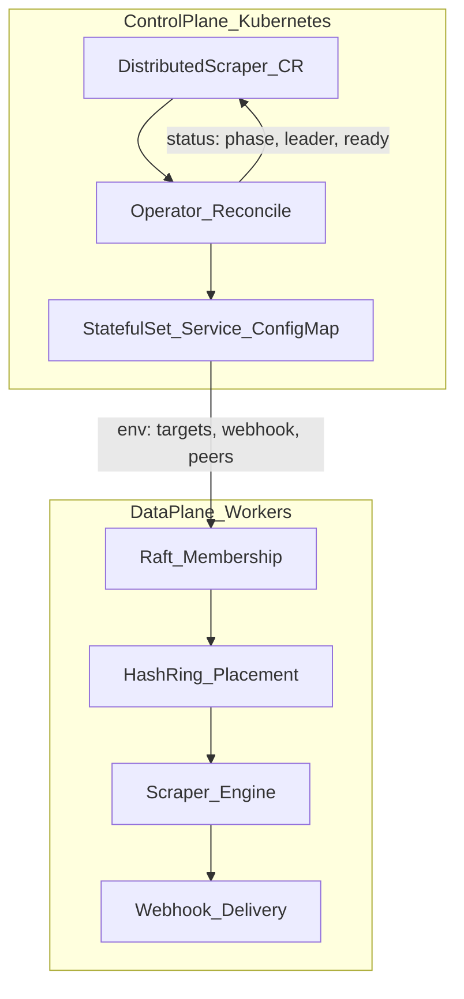

# Affinity — Architecture Phases

A build order for **thinking** about the distributed scraper system, not a feature checklist. Each phase should end with written **invariants** ("what must always be true") before implementation.

## The Spine



- **Control plane** = how many workers, what targets, what webhook.
- **Data plane** = who owns which target right now, scrape it, notify.

Do not mix those concerns in one pass.

---

## Phase 1 — Boundaries and Guarantees ✅ Complete

**Status:** Done. No code in this phase — design contract only. Implementation starts at Phase 2.

### Decisions

| Question | Affinity answer |
| --- | --- |
| What is the unit of work? | One **target** (series ID) polled on `syncInterval` |
| What is success? | New chapter detected and delivered with **idempotent** webhook effects — practically once per user-visible alert |
| What can fail? | Worker death, leader death, scrape errors, webhook timeout/5xx, network partition |
| What consistency do we need? | At-least-once scrape + at-least-once delivery attempts + **idempotent effects** (not exactly-once end-to-end) |
| Webhook on timeout | **Unknown** — verify local outbox state before retry; do not assume failure |
| Delivery state store | **Leader-replicated via Raft** — simplifies ring rebalance and failover (successor reads same outbox) |
| Scrape retry policy | Exponential backoff on failed scrapes, capped at ~10 minutes |
| Leader election SLO | New leader elected in **< 300ms** |
| Failover SLO | On worker death, load reassigned to ring neighbors in **< 10s** total |

### System invariants

1. Every target in `spec.targetList` is owned by exactly one **live** worker at steady state.
2. A webhook for `(target, chapter)` is never duplicated in **normal operation** (idempotency key + durable outbox + fencing).
3. On worker death, load transfers to neighbors on the hash ring within 10 seconds.
4. New Raft leaders are elected within 300ms.
5. Failed scrapes retry with exponential backoff until ~10 minutes.
6. Webhook delivery is **not** complete until ack is recorded in leader-replicated outbox; timeout = unknown, not failed.
7. Stale workers (zombies) cannot commit delivery state after ring epoch advances (fencing).

### Delivery model (webhook)

```
detected → delivery_pending (Raft outbox) → POST → delivered | retry_if_still_pending
```

- **Idempotency key:** `(target_id, chapter_number)`
- **On timeout/partition:** treat as unknown; consult outbox before retrying POST
- **Tradeoff accepted:** optimize for **no missed alerts**; duplicates prevented by idempotent outbox + dedupe key, not by hoping the network is reliable

**Repo touchpoint:** `api/v1/distributedscraper_types.go` — Spec encodes *desired* state; Phase 2+ encodes *observed* state to match these guarantees.
---

## Phase 2 — API: Desired vs Observed ✅ Complete

**Status:** Done. Spec unchanged; Status semantics locked for MVP.

### Decisions

| Topic | Decision |
| --- | --- |
| Where Status lives | On the **CR** — durable, aggregated cluster truth; not only worker logs |
| Phase vs conditions | **`phase`** = lifecycle; **`conditions`** = health detail |
| Partial worker readiness | `phase: Running` + `WorkersReady=False` (not `Degraded`) |
| No Raft leader | `phase: Running` + `LeaderElected=False` |
| `Degraded` phase | **Unused for MVP** — rely on conditions instead |
| Phase transitions (MVP) | `Pending` → `Provisioning` → `Running` |

### Phase transitions

| Phase | When |
| --- | --- |
| `Pending` | CR created; operator has not reconciled child resources yet |
| `Provisioning` | Operator is creating/updating ConfigMap, Service, StatefulSet |
| `Running` | StatefulSet exists (pods may still be starting; check conditions) |

### Conditions (MVP)

| Condition | True when |
| --- | --- |
| `WorkersReady` | `status.readyWorkers == spec.workerNodes` |
| `LeaderElected` | `status.leaderNode` is set (populated in Phase 5, not Phase 3) |
| `TargetsAssigned` | every target has a ring owner (Phase 6) |

### Status fields (existing types — no API change needed for Phase 3)

- `phase`, `leaderNode`, `readyWorkers`, `lastSyncTime`, `conditions`

**Repo:** `api/v1/distributedscraper_types.go`

---

## Phase 3 — Control Plane: Operator Reconcile 🔲 Next

**Goal:** `kubectl apply` CR → operator creates ConfigMap + headless Service + StatefulSet → Status updates.

**Repo:** `internal/controller/distributedscraper_controller.go`

### Blueprint (confirm before implementation)

Answer **yes / tweak** to each block below. Defaults are chosen to match existing worker env vars in `cmd/worker/main.go`.

#### 1. Child resource naming

All children live in the **same namespace** as the CR. Names derived from CR name `{name}`:

| Resource | Name | Example (`name: manhwa-tracker`) |
| --- | --- | --- |
| ConfigMap (targets) | `{name}-targets` | `manhwa-tracker-targets` |
| Headless Service | `{name}-workers` | `manhwa-tracker-workers` |
| StatefulSet | `{name}-workers` | `manhwa-tracker-workers` |

StatefulSet `serviceName` = `{name}-workers` (headless Service).

#### 2. What the operator creates

```
DistributedScraper (CR)
  └── owns → ConfigMap      (targetList)
  └── owns → Service        (headless, clusterIP: None, port 7946)
  └── owns → StatefulSet    (worker pods)
```

Owner references on all three so deleting the CR cascades cleanup.

#### 3. ConfigMap contents

Key `targets.yaml` — newline-separated target IDs from `spec.targetList`:

```
solo-leveling
omniscient-reader
tower-of-god
```

Workers read this in Phase 4; Phase 3 only creates the object.

#### 4. Worker container env (from spec)

| Env var | Source | Default |
| --- | --- | --- |
| `POD_NAME` | Downward API `metadata.name` | pod name |
| `NODE_ID` | same as `POD_NAME` | — |
| `BIND_ADDR` | literal | `:7946` |
| `BOOTSTRAP` | `"true"` if pod ordinal == 0, else `"false"` | — |
| `DATA_DIR` | literal | `/data/raft` |
| `SYNC_INTERVAL` | `spec.syncInterval` | `30s` |
| `WEBHOOK_URL` | `spec.webhookDestination` | — |
| `PEER_ADDRS` | **deferred to Phase 4** — empty for Phase 3 MVP | — |

#### 5. Worker image and storage (MVP)

| Decision | Default |
| --- | --- |
| Container image | `distriscrape-worker:latest` (from Makefile) |
| Raft storage | `emptyDir` at `/data/raft` for Phase 3 — **PVC in Phase 4** |
| Replicas | `spec.workerNodes` |
| Resources | none (add limits in Phase 11) |

#### 6. Reconcile loop order

1. `Get` CR; `NotFound` → return nil
2. Reconcile ConfigMap → Service → StatefulSet (create or update)
3. Read StatefulSet `.status.readyReplicas` → `status.readyWorkers`
4. Set `phase`: `Provisioning` while creating; `Running` once StatefulSet exists
5. Set `WorkersReady` condition from ready count vs desired
6. `Status().Update` (skip `leaderNode` / `LeaderElected` until Phase 5)
7. Requeue after ~30s while `readyWorkers < workerNodes`

#### 7. Out of scope for Phase 3

- Finalizers, Secrets for webhook URL, operator HA
- Raft, hash ring, scraping, webhooks
- `leaderNode`, `lastSyncTime`, `LeaderElected`, `TargetsAssigned`

#### 8. Proof of done

```bash
kubectl apply -f examples/manhwa-tracker.yaml
kubectl get distributedscraper manhwa-tracker
# PHASE=Running, READY=3/3 (once pods start)
kubectl get sts,svc,cm -l app.kubernetes.io/instance=manhwa-tracker
```

**Failure to design for:** `workerNodes` 3→5 while running — operator patches StatefulSet replicas; data plane handles membership in Phase 5+.

**Do not start Raft until** you can draw: YAML applied → what Kubernetes objects exist.
---

## Phase 4 — Worker Identity and Bootstrap

**Decide:**

- **Stable node ID** = StatefulSet pod name (`worker-0`, …) — see `cmd/worker/main.go`
- **Ordinal 0 bootstraps Raft** (`Bootstrap: true`)
- **Peer discovery** = headless service DNS or `PEER_ADDRS` from operator

**Invariant:** A node's identity must survive pod restart on the same ordinal (PVC for Raft `DataDir`).

**Repo:** `RaftNodeConfig`, env in `cmd/worker/main.go`

**Learning check:** Why StatefulSet and not Deployment for workers?

---

## Phase 5 — Cluster Membership (Raft)

**Think before hash ring:**

Raft answers: **who is in the cluster, who is leader, what config is authoritative.**

- Only the **leader** mutates cluster config (add/remove voters)
- Followers redirect `Join` to leader (`internal/worker/server.go`)
- Replicated state: membership + ring epoch / assignments + **delivery outbox** (Phase 1 decision)

**Failure to design for:** Split brain — two nodes both think they're leader. Raft's term/leader check is the fencing foundation.

**Repo:** `internal/worker/raft.go`

**Order rule:** Membership stable → then placement. Not the reverse.

---

## Phase 6 — Work Placement (Consistent Hash Ring)

**Decide:**

1. **Key** = target ID from `targetList`
2. **Ring members** = live worker node IDs
3. **Leader computes** `target → owner` from ring
4. **Leader pushes** assignments via `TaskHandoff` RPC

**On membership change** (join/leave):

1. Update ring
2. Compute diff: which targets moved from A → B
3. Hand off to new owners
4. Old owner **stops** scraping keys it no longer owns (epoch/lease)

**Repo:** `internal/worker/hashring.go`, `TaskHandoff` in `internal/worker/server.go`

**Invariant:** At steady state, each target appears in exactly one worker's `engine.targets`.

---

## Phase 7 — Execution (Scrape Loop)

**Think in order:**

1. **Poll** on interval (per-node, only owned targets)
2. **Fetch** + **parse** (network vs parsing split — `internal/scraper/engine.go`)
3. **Detect new** (high-water mark per target — numeric compare, not string)
4. **Side effect** = webhook (separate from detection)

**Failure to design for:** Scrape succeeds, webhook fails — is chapter "seen" or not? That's the atomicity choice (`not started` until webhook ack + idempotency key).

**Repo:** `internal/scraper/engine.go`

---

## Phase 8 — Delivery and Idempotency

**Decided in Phase 1** (implement here):

- **Idempotency key:** `(target_id, chapter_number)`
- **Store:** leader-replicated **outbox in Raft FSM** (not per-worker PVC)
- **On timeout:** unknown → read outbox → retry only if still `pending`
- **On 2xx:** mark `delivered` in Raft before advancing scrape high-water
- **Retry:** backoff on webhook 5xx and on verified-pending retries

**Industry pattern:** transactional **outbox** — write "pending notification" to Raft, then deliver; retry until ack.

**This is where** leases + fencing tokens attach to real code paths (ring epoch gates outbox writes).

---

## Phase 9 — Failure Detection and Recovery 🟡 Partial

**Implemented (standalone, unit-tested in `internal/worker/recovery_test.go`):**

| Mechanism | Code |
| --- | --- |
| K8s liveness | `LivenessHandler` (`health.go`), served on `HEALTH_ADDR` (`:8080`) at `/healthz`; no Raft/peer dependency by design |
| Heartbeat failure detector | `FailureDetector` (`failure.go`): Alive → Suspect (2s) → Dead (5s); `Server.Heartbeat` feeds it |
| Ring rebalance | `HashRing` implemented; `RecoverFromFailure` / `DiffAssignments` (`rebalance.go`) — only the dead node's targets move |
| Zombie fencing | `EpochFence` (`fence.go`): epoch bumps on every membership change; stale-epoch writes get `ErrStaleEpoch` |

**Not yet wired (blocked on Phases 4–8):** Raft is still stubbed, so nothing yet calls `Check()` on a timer, commits removal + epoch through the log, pushes `TaskHandoff`, or checks the fence on outbox commits. Leader-election-during-handoff and 3→5 scale-up scenarios need those first.

**Order of mechanisms:**

1. **K8s liveness** — pod dead → replaced
2. **Raft** — leader dead → new election
3. **Heartbeats** between workers (`Heartbeat` in `server.go`) — optional supplement, not substitute for Raft
4. **Ring rebalance** — dead node removed, targets reassigned
5. **Zombie handling** — stale owner can't commit (epoch/lease)

**Walkthrough scenarios** (one per study session):

- Worker-1 dies mid-scrape
- Worker-1 slow, not dead (zombie)
- Leader dies during handoff
- Operator scales 3→5 workers

---

## Phase 10 — Observability and Ops

**After** core loop works:

- Structured logs (node, target, leader term)
- Metrics: scrape latency, webhook failures, ring rebalance count
- Status conditions on CR (`Ready`, `LeaderElected`, `TargetsAssigned`)
- Health endpoints on operator and worker

Platform interviews care that you can **debug** the system, not only draw it.

---

## Phase 11 — Hardening (Later)

- Operator leader election (HA operator)
- Rate limiting / backoff per source site
- Secrets for webhook URL (not plain spec)
- CRD validation webhooks
- Chaos tests (kill pod, partition network)

---

## Learning Loop

For each phase:

1. **You** write: inputs, outputs, one failure, invariant preserved
2. **Challenge** one hole in the design
3. **Revise** the approach
4. **Implement** that slice only
5. **Retrieve:** explain the change without re-reading a summary

---

## Suggested Build Order (First Three Weeks)

| Week | Phase | Prove it works |
| --- | --- | --- |
| 1 | 2 + 3 | Apply CR → StatefulSet exists → Status shows `Provisioning`/`Running` |
| 2 | 4 + 5 | 3 worker pods → Raft leader elected → `status.leaderNode` set |
| 3 | 6 + 7 | Leader assigns targets → one pod scrapes each → fake chapter → webhook |

Skip Discord polish and multi-source parsers until week 3's path works with a stub `FetchTarget`.

---

## Phase Progress

| Phase | Status |
| --- | --- |
| 1 — Boundaries and Guarantees | ✅ Complete |
| 2 — API: Desired vs Observed | ✅ Complete |
| 3 — Control Plane: Operator Reconcile | 🔲 Next (blueprint below) |
| 4 — Worker Identity and Bootstrap | 🔲 |
| 5 — Cluster Membership (Raft) | 🔲 |
| 6 — Work Placement (Hash Ring) | 🔲 |
| 7 — Execution (Scrape Loop) | 🔲 |
| 8 — Delivery and Idempotency | 🔲 |
| 9 — Failure Detection and Recovery | 🟡 Partial (standalone pieces; wiring blocked on 4–8) |
| 10 — Observability and Ops | 🔲 |
| 11 — Hardening | 🔲 |
